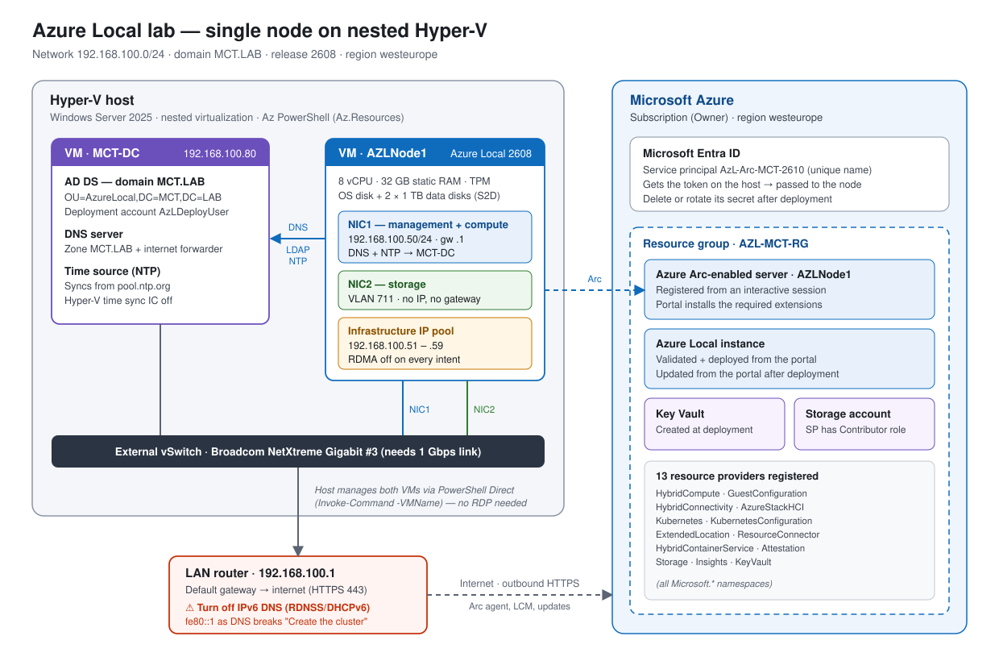

# Azure Local Lab Deployment Guide

**Single node · nested Hyper-V · field-tested**



*Every step and fix in this guide comes from a real deployment that completed on 9 November 2026.*

> **Lab and training use only.** Microsoft doesn't support nested Azure Local for production. The original Word version is in [`docs/AzureLocal-Lab-Deployment-Guide-v3.docx`](docs/AzureLocal-Lab-Deployment-Guide-v3.docx).

| **Item**         | **Value**                                                                |
|------------------|--------------------------------------------------------------------------|
| ISO              | AzureLocal24H2.26100.32230.LCM.12.2608.0.3020.x64.en-us.iso              |
| Version deployed | Release **2608** (OS 26100.33296), then updated from the portal          |
| Lab              | Host + MCT-DC (domain MCT.LAB) + node AZLNode1, network 192.168.100.0/24 |
| Guide version    | 3.0 — November 2026 (replaces 2.0)                                       |

## Contents

- [Before you start](#before-you-start)
- [1. Prerequisites](#1-prerequisites)
- [2. Phase 0 — Tools on the Hyper-V host](#2-phase-0--tools-on-the-hyper-v-host)
- [3. Phase 1 — Azure preparation](#3-phase-1--azure-preparation)
- [4. Phase 2 — Active Directory and time (on the DC)](#4-phase-2--active-directory-and-time-on-the-dc)
- [5. Phase 3 — Create the node VM](#5-phase-3--create-the-node-vm)
- [6. Phase 4 — Install the OS](#6-phase-4--install-the-os)
- [7. Phase 5 — Network, time zone, name (from the host)](#7-phase-5--network-time-zone-name-from-the-host)
- [8. Phase 6 — Register with Azure Arc](#8-phase-6--register-with-azure-arc)
- [9. Phase 7 — Deploy from the portal](#9-phase-7--deploy-from-the-portal)
- [10. Fix: router IPv6 DNS breaks "Create the cluster"](#10-fix-router-ipv6-dns-breaks-create-the-cluster)
- [11. After deployment](#11-after-deployment)
- [12. Troubleshooting — every error we hit](#12-troubleshooting--every-error-we-hit)
- [13. Checklist](#13-checklist)
- [Appendix — Changes from version 2.0](#appendix--changes-from-version-20)

## Before you start

> **Important:** Lab and training use only. Microsoft doesn’t support nested Azure Local for production, and it runs much slower than physical hardware.

This guide builds a **single-node Azure Local instance inside a Hyper-V VM**. Version 2.0 described the documented path. This version adds what actually happened when we ran it: every error we hit, why it happened, and the fix that worked. The fixes are built into the steps, so if you follow the guide in order, you shouldn’t hit them.

### The ten lessons that matter most

| **\#** | **Lesson**                                                                                                                                                                                                     | **Section** |
|--------|----------------------------------------------------------------------------------------------------------------------------------------------------------------------------------------------------------------|-------------|
| 1      | **Your router can break the deployment.** A home or office router that advertises itself as an IPv6 DNS server makes the node lose the domain at the "Create the cluster" step. Check for it before you start. | 1.5, 10     |
| 2      | The Azure Local password rule (14+ characters, all four character types) is **stricter than AD’s**. AD accepts passwords that later fail deployment. Check them with the script in 4.1.                        | 4.1         |
| 3      | Don’t force TargetSolutionVersion. The ISO only accepts certain targets. Leave it out, register in an **interactive** session, and pick from the list.                                                         | 8           |
| 4      | Your Az PowerShell needs the **Az.Resources** module, and the AD tool needs the **ActiveDirectory** and **GroupPolicy** modules. Run the AD step **on the DC**.                                                | 2, 4.2      |
| 5      | Give each deployment a **uniquely named** service principal. Several apps with the same name break every script that looks it up by name.                                                                      | 3.3         |
| 6      | Turn off **RDMA** on every intent with \*Customize network settings\*. A nested VM can’t do RDMA, and leaving it on also triggers the 10 Gbps bandwidth check.                                                 | 9.3         |
| 7      | "Network Infra Connection — The parameter is incorrect" was a one-off timing failure. **Run validation again** before you change anything.                                                                     | 9.5         |
| 8      | The portal installs the Arc extensions when you add the machine. **You don’t install them yourself.**                                                                                                          | 9.2         |
| 9      | Watch the **host’s link speed**. Ours negotiated 100 Mbps, which makes downloads and deployment very slow.                                                                                                     | 1.1, 7.3    |
| 10     | Never paste passwords or secrets into a chat, a ticket or a script. Use Get-Credential or Read-Host -AsSecureString.                                                                                           | All         |

### How the deployment flows

| **Phase**     | **What you do**                                               | **Where**                        |
|---------------|---------------------------------------------------------------|----------------------------------|
| 0\. Tools     | Az modules and AD tools                                       | Hyper-V host                     |
| 1\. Azure     | Resource providers, resource group, service principal + roles | Hyper-V host                     |
| 2\. AD + time | OU, deployment account, NTP, DNS sanity check                 | DC (via PowerShell Direct)       |
| 3\. VM        | Create the node VM                                            | Hyper-V host                     |
| 4\. OS        | Install from the ISO, local admin password                    | VM console                       |
| 5\. Network   | NIC names, static IP, time zone, NTP, rename, RDP             | Hyper-V host (PowerShell Direct) |
| 6\. Arc       | Register with Arc; the node updates its OS                    | Interactive session on the node  |
| 7\. Portal    | Extensions, validation, deployment                            | Azure portal                     |
| 8\. Fix-ups   | DNS fix if "Create the cluster" fails                         | Hyper-V host                     |
| 9\. After     | Update, clean up secrets                                      | Portal + host                    |

## 1. Prerequisites

### 1.1 Hyper-V host

| **Component** | **Requirement**                                                                     | **In our lab**                                           |
|---------------|-------------------------------------------------------------------------------------|----------------------------------------------------------|
| OS            | Windows Server 2022/2025 or Windows 11 with Hyper-V; CPU with nested virtualization | Windows Server 2025                                      |
| RAM           | 48 GB free (the VM uses 32 GB static)                                               |                                                          |
| CPU           | 8 free logical processors (4 minimum)                                               | 8 vCPUs                                                  |
| Disk          | About 130 GB for the OS disk + about 2 TB for two 1 TB data disks (dynamic)         | OS on C:, data disks on E:\DataDisk                      |
| Network       | External vSwitch on a **1 Gbps or faster** link                                     | Broadcom NetXtreme Gigabit Ethernet \#3 - Virtual Switch |
| Internet      | Outbound HTTPS from the host and the node VM                                        |                                                          |

### 1.2 Azure

- A subscription where you are **Owner**. A Visual Studio subscription works.

- A **personal Microsoft account** works for the portal. For Arc registration it’s more reliable to use a service principal (section 3.3).

- A region that supports Azure Local. This guide uses westeurope.

### 1.3 Active Directory

- A DC VM on the same host. In this guide that’s MCT-DC, domain MCT.LAB, at 192.168.100.80.

- A dedicated OU. The AD tool creates it, along with the deployment account.

### 1.4 Passwords: the rule Azure Local enforces

| **Account**                        | **Rule**                                                                                                                                                                                                                                                             |
|------------------------------------|----------------------------------------------------------------------------------------------------------------------------------------------------------------------------------------------------------------------------------------------------------------------|
| Deployment account (AzLDeployUser) | **14+ characters**, with a lowercase letter, an uppercase letter, a number and a special character. Username: 1–20 characters, using letters, numbers, - and \_. It can’t start with a number or -, can’t be admin, and must be different from the local admin name. |
| Node local Administrator           | The same password rule                                                                                                                                                                                                                                               |
| Practical advice                   | Avoid " ' \$ & \< \> ; and the backtick, which break scripts and JSON. Turn on PasswordNeverExpires in a lab.                                                                                                                                                        |

> **Important:** Active Directory accepted R00t123456789 (13 characters, no special character), but Azure Local would have rejected it later in the deployment. The default domain policy is much weaker than the Azure Local rule, so always check your passwords with the script in section 4.1.

### 1.5 Your LAN router (check this first)

Why does the router matter? Because many home and office routers advertise **themselves as an IPv6 DNS server** (through router advertisements or DHCPv6). Windows then asks the router \*and\* your DC. The router answers "name does not exist" for MCT.LAB, Windows keeps that answer, and the node loses the domain.

In our lab this broke **"Create the cluster"** with DNS name does not exist for AZLNode1.mct.lab. The router was 192.168.100.1, which also answered over IPv6 as fe80::1.

**Best fix:** turn off IPv6 DNS advertisement (RDNSS/DHCPv6) on the router before you start. If you can’t change the router, section 10 has the tested fix for the node.

**Quick test, from any Windows machine on the LAN** (here the host):

```powershell
Get-DnsClientServerAddress -AddressFamily IPv6 |
Where-Object ServerAddresses | Select-Object InterfaceAlias, ServerAddresses
# Anything like fe80::1 here = your router hands out IPv6 DNS
```

## 2. Phase 0 — Tools on the Hyper-V host

Do this once, in an **elevated** PowerShell on the host.

```powershell
[Net.ServicePointManager]::SecurityProtocol = [Net.SecurityProtocolType]::Tls12
Install-Module Az -Scope AllUsers -Force -AllowClobber # includes Az.Accounts + Az.Resources
Import-Module Az.Accounts, Az.Resources
Get-Command Register-AzResourceProvider, New-AzADServicePrincipal | Select-Object Name, Source
```

> **Note:** We first had only Az.Accounts installed. Connect-AzAccount worked, but every \*-AzResourceProvider command failed with "not recognized". If you’re short on space, Install-Module Az.Resources is enough. PowerShell 7 is recommended, but Windows PowerShell 5.1 works too. Modules have to be installed separately in each one.

### 2.1 Lab values used in every script

Paste this block at the top of every new PowerShell window. All the later scripts use these variables.

```powershell
$Tenant = '<TENANT-ID>'
$Sub = '<SUBSCRIPTION-ID>'
$RG = 'AZL-MCT-RG'
$Region = 'westeurope'
$SPName = 'AzL-Arc-MCT-2610' # unique per deployment
$DomainDN = 'DC=MCT,DC=LAB'
$OU = "OU=AzureLocal,$DomainDN"
$DCVM = 'MCT-DC'
$DCIP = '192.168.100.80'
$NodeVM = 'AZLNode1'
$NodeIP = '192.168.100.50'
$Gateway = '192.168.100.1'
```

## 3. Phase 1 — Azure preparation

### 3.1 Register the resource providers

```powershell
Connect-AzAccount -TenantId $Tenant -SubscriptionId $Sub
$providers = @(
'Microsoft.HybridCompute','Microsoft.GuestConfiguration','Microsoft.HybridConnectivity',
'Microsoft.AzureStackHCI','Microsoft.Kubernetes','Microsoft.KubernetesConfiguration',
'Microsoft.ExtendedLocation','Microsoft.ResourceConnector','Microsoft.HybridContainerService',
'Microsoft.Attestation','Microsoft.Storage','Microsoft.Insights','Microsoft.KeyVault'
)
foreach ($p in $providers) { Register-AzResourceProvider -ProviderNamespace $p | Out-Null }
# Wait until all 13 say Registered
do {
$pending = foreach ($p in $providers) {
$s = (Get-AzResourceProvider -ProviderNamespace $p | Select-Object -First 1).RegistrationState
if ($s -ne 'Registered') { "$p : $s" }
}
if ($pending) { Write-Host "Waiting on:"; $pending; Start-Sleep 30 }
} while ($pending)
Write-Host 'All 13 providers Registered' -ForegroundColor Green
```

> **Note:** If the loop shows a provider with an empty state forever, Get-AzResourceProvider isn’t installed (see section 2). Press Ctrl+C.

### 3.2 Create a new resource group for this deployment

```powershell
New-AzResourceGroup -Name $RG -Location $Region -Force | Out-Null
$Scope = (Get-AzResourceGroup -Name $RG).ResourceId
```

Use a **fresh resource group** for each attempt. We left the earlier group (AZLCASA) with its leftovers and started clean in AZL-MCT-RG.

### 3.3 Create the service principal and its roles

Why a service principal? A personal Microsoft account can’t reliably sign in with device code on the node. The SP gets an access token on the host, and the token is passed to the node.

```powershell
if (Get-AzADServicePrincipal -DisplayName $SPName) { throw "SP $SPName already exists - choose a new name" }
$sp = New-AzADServicePrincipal -DisplayName $SPName
$spAppId = $sp.AppId
$spSecret = $sp.PasswordCredentials.SecretText
Start-Sleep -Seconds 45 # Entra ID replication
$roles = @(
'Azure Connected Machine Onboarding','Azure Connected Machine Resource Administrator',
'Azure Stack HCI Administrator','Reader',
'Key Vault Data Access Administrator','Key Vault Secrets Officer',
'Key Vault Contributor','Storage Account Contributor'
)
foreach ($r in $roles) {
try {
New-AzRoleAssignment -ApplicationId $spAppId -RoleDefinitionName $r -Scope $Scope -ErrorAction Stop | Out-Null
Write-Host "Assigned: $r"
} catch {
if ($_.Exception.Message -match 'RoleAssignmentExists') { Write-Host "Already there: $r" }
else { Write-Host "FAILED: $r - $($_.Exception.Message)" -ForegroundColor Red }
}
}
Get-AzRoleAssignment -ServicePrincipalName $spAppId -Scope $Scope | Select-Object RoleDefinitionName
Write-Host "AppId : $spAppId"
Write-Host "Secret: $spSecret" # copy into a password manager - shown only once
```

> **Important:** Keep the secret in a password manager only, never in chats, tickets or scripts. We pasted one into a chat and had to plan to delete the SP straight after deployment. If you lose the secret, create a new one: New-AzADAppCredential -ApplicationId \$spAppId -EndDate (Get-Date).AddMonths(3).

> **Note:** You don’t need to assign roles to your own account if you’re Owner of the subscription. "RoleAssignmentExists" (Conflict) just means the role was already there, and is harmless.

#### Clean up old service principals

Earlier attempts left **five** apps called AzureLocalArcSP, so \$app.AppId returned five IDs and New-AzADAppCredential failed with "Cannot convert System.Object\[\] to System.Guid". Remove the old ones:

```powershell
Get-AzADApplication -DisplayName 'AzureLocalArcSP' | ForEach-Object {
Get-AzRoleAssignment -ServicePrincipalName $_.AppId -ErrorAction SilentlyContinue |
Remove-AzRoleAssignment -ErrorAction SilentlyContinue | Out-Null
Remove-AzADApplication -ObjectId $_.Id
Write-Host "Removed $($_.AppId)"
}
```

## 4. Phase 2 — Active Directory and time (on the DC)

### 4.1 Password checker

Paste this function into your host PowerShell window. The AD and node steps use it.

```powershell
function Test-AzLPassword ([securestring]$Secure) {
$p = [System.Net.NetworkCredential]::new('', $Secure).Password
$issues = @()
if ($p.Length -lt 14) { $issues += '14+ characters' }
if ($p -cnotmatch '[a-z]') { $issues += 'a lowercase letter' }
if ($p -cnotmatch '[A-Z]') { $issues += 'an uppercase letter' }
if ($p -notmatch '\d') { $issues += 'a number' }
if ($p -notmatch '[^a-zA-Z0-9]') { $issues += 'a special character' }
if ($p -match '["''$&<>;]' -or $p.Contains([string][char]96)) { $issues += 'none of " '' $ & < > ; or backtick' }
$issues
}
```

### 4.2 Create the OU and deployment account (through PowerShell Direct)

Why on the DC? Because the AD tool needs the **ActiveDirectory** and **GroupPolicy** modules. Running it on the host failed with \*"The specified module ‘ActiveDirectory’ was not loaded"\*. PowerShell Direct gets you onto the DC from the host without RDP:

```powershell
$daCred = Get-Credential -UserName 'MCT\Administrator' -Message 'Domain admin'
do {
$lcmCred = Get-Credential -UserName 'AzLDeployUser' -Message 'Password for the deployment account'
$problems = Test-AzLPassword $lcmCred.Password
if ($problems) { Write-Host "Password needs: $($problems -join ', ')" -ForegroundColor Yellow }
} while ($problems)
Invoke-Command -VMName $DCVM -Credential $daCred -ArgumentList $lcmCred, $OU -ScriptBlock {
param($lcmCred, $OU)
[Net.ServicePointManager]::SecurityProtocol = [Net.SecurityProtocolType]::Tls12
Install-Module AsHciADArtifactsPreCreationTool -Repository PSGallery -Force
New-HciAdObjectsPreCreation -AzureStackLCMUserCredential $lcmCred -AsHciOUName $OU
Set-ADUser -Identity 'AzLDeployUser' -PasswordNeverExpires $true
Get-ADUser 'AzLDeployUser' -Properties PasswordNeverExpires | Select-Object SamAccountName, Enabled, PasswordNeverExpires, DistinguishedName
}
```

Expected output: Successfully verified DC=MCT,DC=LAB, created AzureLocal organization unit, created ‘AzLDeployUser’, Access permissions … granted, and Gpo inheritance blocked … True.

> **Note:** The tool **creates** the account. To change its password later, use Set-ADAccountPassword -Identity AzLDeployUser -Reset -NewPassword (Read-Host -AsSecureString) on the DC. If the DC has no internet access, install the module on the host and copy it to the DC with Copy-Item -ToSession.

### 4.3 Time on the DC

```powershell
Invoke-Command -VMName $DCVM -Credential $daCred -ScriptBlock {
Set-TimeZone -Id 'Morocco Standard Time'
w32tm /config /manualpeerlist:"pool.ntp.org" /syncfromflags:manual /reliable:YES /update
Restart-Service w32time
w32tm /resync /force
w32tm /query /status | Select-String 'Source|Stratum|Last Successful'
}
Disable-VMIntegrationService -VMName $DCVM -Name 'Time Synchronization'
```

Expected: Source: pool.ntp.org and Stratum 2 or 3. Check the time zone too. Our DC was still on Pacific time, which made the logs confusing.

### 4.4 DNS sanity check on the DC

```powershell
Invoke-Command -VMName $DCVM -Credential $daCred -ScriptBlock {
Get-DnsServerForwarder | Select-Object IPAddress
Get-DnsClientServerAddress | Where-Object ServerAddresses | Select-Object InterfaceAlias, AddressFamily, ServerAddresses
}
```

- **Forwarders:** there must be at least one, or the node can’t resolve Azure names. To add one: Add-DnsServerForwarder -IPAddress 8.8.8.8.

- **DNS client:** the DC should list only itself (and ::1). If you see fe80::1, your router is handing out IPv6 DNS. Fix the router (section 1.5), or apply the section 10 fix to the DC too.

## 5. Phase 3 — Create the node VM

In our lab the OS disk goes on C: and the two data disks on E:\DataDisk. Change the paths and the switch name for your host.

```powershell
$VMPath = "C:\HYPERVMs\$NodeVM" # VM config + OS disk
$DataPath = 'E:\DataDisk' # data disks for Storage Spaces Direct
$SwitchName = 'Broadcom NetXtreme Gigabit Ethernet #3 - Virtual Switch'
$vCPU = 8
$DataDiskSize = 1TB
$ISOPath = 'C:\Users\Administrator\Downloads\ISO\AzureLocal24H2.26100.32230.LCM.12.2608.0.3020.x64.en-us.iso'
if (-not (Test-Path $ISOPath)) { throw "ISO not found: $ISOPath" }
if (-not (Get-VMSwitch -Name $SwitchName -ErrorAction SilentlyContinue)) { throw "vSwitch not found" }
if (Get-VM -Name $NodeVM -ErrorAction SilentlyContinue) { throw "$NodeVM already exists" }
New-Item -Path $VMPath, $DataPath -ItemType Directory -Force | Out-Null
New-VM -Name $NodeVM -Generation 2 -MemoryStartupBytes 32GB -Path $VMPath -NoVHD -SwitchName $SwitchName
New-VHD -Path "$VMPath\$NodeVM-OS.vhdx" -SizeBytes 127GB -Dynamic | Out-Null
Add-VMHardDiskDrive -VMName $NodeVM -Path "$VMPath\$NodeVM-OS.vhdx"
foreach ($i in 1..2) {
$d = Join-Path $DataPath "$NodeVM-S2D$i.vhdx"
New-VHD -Path $d -SizeBytes $DataDiskSize -Dynamic | Out-Null
Add-VMHardDiskDrive -VMName $NodeVM -Path $d
}
Add-VMDvdDrive -VMName $NodeVM -Path $ISOPath
Set-VMFirmware -VMName $NodeVM -FirstBootDevice (Get-VMDvdDrive -VMName $NodeVM)
Set-VMMemory -VMName $NodeVM -DynamicMemoryEnabled $false
Set-VM -VMName $NodeVM -CheckpointType Disabled -AutomaticCheckpointsEnabled $false
Set-VMProcessor -VMName $NodeVM -Count $vCPU -ExposeVirtualizationExtensions $true
Set-VMKeyProtector -VMName $NodeVM -NewLocalKeyProtector
Enable-VMTPM -VMName $NodeVM
Get-VMNetworkAdapter -VMName $NodeVM | Remove-VMNetworkAdapter
Add-VMNetworkAdapter -VMName $NodeVM -Name 'NIC1' -SwitchName $SwitchName
Add-VMNetworkAdapter -VMName $NodeVM -Name 'NIC2' -SwitchName $SwitchName
Get-VMNetworkAdapter -VMName $NodeVM | Set-VMNetworkAdapter -MacAddressSpoofing On -AllowTeaming On
Get-VMNetworkAdapter -VMName $NodeVM | Set-VMNetworkAdapterVlan -Trunk -NativeVlanId 0 -AllowedVlanIdList '0-1000'
Disable-VMIntegrationService -VMName $NodeVM -Name 'Time Synchronization'
Get-VMHardDiskDrive -VMName $NodeVM | Select-Object ControllerLocation, Path
```

### 5.1 Check the VM before first boot

```powershell
[pscustomobject]@{
vCPU = (Get-VMProcessor $NodeVM).Count
Nested = (Get-VMProcessor $NodeVM).ExposeVirtualizationExtensions
MemoryGB = (Get-VMMemory $NodeVM).Startup/1GB
DynamicMem = (Get-VMMemory $NodeVM).DynamicMemoryEnabled
vTPM = (Get-VMSecurity $NodeVM).TpmEnabled
SecureBoot = (Get-VMFirmware $NodeVM).SecureBoot
TimeSync = (Get-VMIntegrationService $NodeVM -Name 'Time Synchronization').Enabled
Checkpoint = (Get-VM $NodeVM).CheckpointType
}
```

Expected values: 8, True, 32, False, True, On, False, Disabled.

## 6. Phase 4 — Install the OS

1.  In Hyper-V Manager, right-click the node VM and choose **Connect**, then **Start**. Press a key **as soon as** \*Press any key to boot from CD or DVD\* appears.

2.  Choose language and keyboard, then **Install now**, accept the license, and choose **Custom**.

3.  Select the **127 GB** disk. Leave the two 1 TB disks alone.

4.  After the reboot, set the **local Administrator** password using the section 1.4 rule. Type it carefully: a different keyboard layout in the VM console can change characters like @, ", y/z or \#.

5.  Don’t join the domain, and don’t install updates. The Arc bootstrap updates the OS.

## 7. Phase 5 — Network, time zone, name (from the host)

### 7.1 Save a credential for the node

Use **\`.\Administrator\`** (with the dot). In our lab a bare Administrator together with the wrong password gave "The credential is invalid" several times. If that happens, sign in on the VM console to check the password before you try again.

```powershell
$nodeCred = Get-Credential -UserName '.\Administrator' -Message "$NodeVM local admin"
Invoke-Command -VMName $NodeVM -Credential $nodeCred -ScriptBlock { whoami } # expect <name>\administrator
```

### 7.2 Configure NICs, IP, DNS, time zone, NTP

```powershell
$mac1 = (Get-VMNetworkAdapter -VMName $NodeVM -Name 'NIC1').MacAddress -replace '(..)(?!$)', '$1-'
$mac2 = (Get-VMNetworkAdapter -VMName $NodeVM -Name 'NIC2').MacAddress -replace '(..)(?!$)', '$1-'
Invoke-Command -VMName $NodeVM -Credential $nodeCred -ArgumentList $mac1,$mac2,$NodeIP,$Gateway,$DCIP -ScriptBlock {
param($mac1, $mac2, $ip, $gw, $dns)
Get-NetAdapter | Where-Object MacAddress -eq $mac1 | Rename-NetAdapter -NewName 'NIC1'
Get-NetAdapter | Where-Object MacAddress -eq $mac2 | Rename-NetAdapter -NewName 'NIC2'
Start-Sleep 2
Set-NetIPInterface -InterfaceAlias 'NIC1' -Dhcp Disabled
Get-NetIPAddress -InterfaceAlias 'NIC1' -AddressFamily IPv4 -ErrorAction SilentlyContinue | Remove-NetIPAddress -Confirm:$false
Get-NetRoute -InterfaceAlias 'NIC1' -AddressFamily IPv4 -ErrorAction SilentlyContinue | Remove-NetRoute -Confirm:$false
New-NetIPAddress -InterfaceAlias 'NIC1' -IPAddress $ip -PrefixLength 24 -DefaultGateway $gw | Out-Null
Set-DnsClientServerAddress -InterfaceAlias 'NIC1' -ServerAddresses $dns
Set-NetIPInterface -InterfaceAlias 'NIC2' -Dhcp Disabled # storage: no IP, no gateway
Set-TimeZone -Id 'Morocco Standard Time'
w32tm /config /manualpeerlist:"$dns" /syncfromflags:manual /update | Out-Null
Restart-Service w32time; Start-Sleep 5; w32tm /resync /force | Out-Null
Get-NetIPConfiguration -InterfaceAlias 'NIC1' | Select-Object InterfaceAlias, IPv4Address, IPv4DefaultGateway, DNSServer
w32tm /query /status | Select-String 'Source'
Get-TimeZone | Select-Object Id
}
```

Expected: Source: 192.168.100.80 and Morocco Standard Time. If the time zone is still Pacific, run Set-TimeZone again. The image’s default is Pacific.

### 7.3 Connectivity, free infra IPs, link speed

```powershell
Invoke-Command -VMName $NodeVM -Credential $nodeCred -ScriptBlock {
[pscustomobject]@{
DC_LDAP = Test-NetConnection 192.168.100.80 -Port 389 -InformationLevel Quiet
DNS = [bool](Resolve-DnsName management.azure.com -ErrorAction SilentlyContinue)
ARM_443 = Test-NetConnection management.azure.com -Port 443 -InformationLevel Quiet
EntraID_443 = Test-NetConnection login.microsoftonline.com -Port 443 -InformationLevel Quiet
}
51..59 | ForEach-Object { "192.168.100.$_ in use: " + (Test-Connection "192.168.100.$_" -Count 1 -Quiet) }
Get-NetAdapter | Select-Object Name, LinkSpeed
}
```

- All four connectivity tests must be **True**, and every .51–.59 must be **False** (free).

- **LinkSpeed:** ours was **100 Mbps** because the host’s NIC had negotiated 100 Mbps. Fix the cable or switch port to get 1 Gbps before you deploy.

### 7.4 Rename the node and enable RDP

```powershell
Invoke-Command -VMName $NodeVM -Credential $nodeCred -ScriptBlock {
Rename-Computer -NewName 'AZLNode1' -Force
Set-ItemProperty 'HKLM:\System\CurrentControlSet\Control\Terminal Server' -Name fDenyTSConnections -Value 0
Enable-NetFirewallRule -DisplayGroup 'Remote Desktop'
}
Restart-VM -Name $NodeVM -Force
```

> **Important:** Rename **before** Arc registration. The Arc resource takes the computer name, and the only clean way to change it afterwards is to reinstall.

## 8. Phase 6 — Register with Azure Arc

### 8.1 What we learned

| **Attempt**                                                  | **Result**                                                                                                             |
|--------------------------------------------------------------|------------------------------------------------------------------------------------------------------------------------|
| TargetSolutionVersion = 12.2610.1004.50 (the latest release) | **Rejected**: "Given TargetSolutionVersion … is not valid". The zero-day update only offers some versions to this ISO. |
| No TargetSolutionVersion, interactive session                | **Succeeded**. The bootstrap updated the node to the ISO’s release: **2608**, OS 26100.**33296**.                      |

**What to do:** leave TargetSolutionVersion out, and run the registration in an **interactive** session so you can answer the version prompt if it appears. Deploy the version you get, then update from the portal (section 11).

### 8.2 Get a token and open a session on the node

Run this on the host, in the window where \$spAppId and the section 2.1 variables are set:

```powershell
$spCred = Get-Credential -UserName $spAppId -Message 'Paste the SP secret as the password'
Connect-AzAccount -ServicePrincipal -Credential $spCred -TenantId $Tenant -SubscriptionId $Sub | Out-Null
$tok = Get-AzAccessToken -ResourceUrl 'https://management.azure.com/'
$ArmAccessToken = [System.Net.NetworkCredential]::new('', $tok.Token).Password # SecureString -> text
$s = New-PSSession -VMName $NodeVM -Credential $nodeCred
Invoke-Command -Session $s -ArgumentList $ArmAccessToken,$Tenant,$Sub,$RG,$Region -ScriptBlock {
param($t, $ten, $sub, $rg, $reg)
$global:params = @{ TenantId=$ten; SubscriptionID=$sub; ResourceGroup=$rg; Region=$reg; Cloud='AzureCloud'; ArmAccessToken=$t }
}
Enter-PSSession $s
```

The prompt changes to \[AZLNode1\]: PS\>. Now run:

```powershell
Invoke-AzStackHciArcInitialization @params
```

### 8.3 Watch it finish

- If the OS needs updating, it takes 40–45 minutes and the node reboots. After the reboot, **get a new token** and run 8.2 again.

- Success looks like ArcRegistration : Succeeded and Bootstrap succeeded.

```powershell
(Get-ArcBootstrapStatus).Response.Status
(Get-ItemProperty 'HKLM:\SOFTWARE\Microsoft\Windows NT\CurrentVersion').UBR # 33296 = 2608
& "$env:ProgramFiles\AzureConnectedMachineAgent\azcmagent.exe" show | Select-String 'Agent Status|Resource Group|Location'
Exit-PSSession
```

> **Important:** Two traps from our lab: (1) Get-ArcZeroDaySolutionUpdateConfig asks for a ConfigFilePath and waits forever. Press Ctrl+C, you don’t need it. (2) While you’re inside \[AZLNode1\], Invoke-Command -VMName AZLNode1 fails with "does not resolve to a single virtual machine", because you’re already on the node. Run the commands directly, or Exit-PSSession first.

## 9. Phase 7 — Deploy from the portal

### 9.1 Start

**Azure Local** → **All systems** → **+ Create**. Choose your subscription, AZL-MCT-RG, the instance name (for example AZLCluster1) and **West Europe**.

### 9.2 Machines and extensions

1.  **+ Add machines**, choose AZLNode1, then **Add**. It may show \*Not validated\* or \*Missing Arc extensions\*. That’s normal at this point.

2.  Wait while the portal **installs the Arc extensions** (10–20 minutes nested), refreshing now and then until the machine shows **Ready**.

3.  **Validate selected machines**.

4.  **Key vault**: create a new one.

### 9.3 Networking

| **Setting**                                   | **Value**                                           |
|-----------------------------------------------|-----------------------------------------------------|
| Pattern                                       | Group management and compute traffic                |
| Management + compute intent                   | NIC1                                                |
| Storage intent                                | NIC2, VLAN **711**                                  |
| Customize network settings (**every** intent) | RDMA protocol: **Disabled**. Jumbo packet: **1514** |
| IP allocation                                 | Manual                                              |
| Infra range                                   | 192.168.100.51 – 192.168.100.59                     |
| Mask / gateway / DNS                          | 255.255.255.0 / 192.168.100.1 / 192.168.100.80      |

> **Important:** If you leave RDMA on, validation fails twice over: **RDMA operational** ("OverrideAdapterProperty – False; NetworkDirect – 1 … platform reports OperationalState=False") and **symmetry/bandwidth** (the storage NIC needs 10 Gbps when RDMA is on). Turning RDMA off on each intent fixes both.

### 9.4 Management, security, advanced

| **Field**           | **Value**                                        |
|---------------------|--------------------------------------------------|
| Custom location     | e.g. AZLCluster1-cl                              |
| Witness             | None (single node)                               |
| Domain / OU         | MCT.LAB / OU=AzureLocal,DC=MCT,DC=LAB            |
| Deployment account  | AzLDeployUser (no MCT\\ prefix) and its password |
| Local administrator | Administrator and the node password              |
| Security            | Recommended (needs the vTPM)                     |
| Advanced            | Defaults                                         |

### 9.5 Validation

**Start validation** takes about 15–30 minutes. Here’s what happened in our lab:

| **Validator error**                                                | **What it was**                                                                                                                                                                                           | **Fix**                                                                           |
|--------------------------------------------------------------------|-----------------------------------------------------------------------------------------------------------------------------------------------------------------------------------------------------------|-----------------------------------------------------------------------------------|
| Azure Local Network Infra Connection: "The parameter is incorrect" | A **one-off timing failure** in the nested VM. Claude Code checked the node and found no leftover switches, no IP conflicts and no IPv6 problems, and the same command succeeded in two isolated repeats. | **Run validation again.** It passed the second time. Don’t change anything first. |
| RDMA operational / symmetry and bandwidth                          | RDMA left on                                                                                                                                                                                              | Section 9.3                                                                       |

### 9.6 Deploy

**Review + create** → **Create**. A single physical node takes 1.5–2 hours; nested takes longer. Follow it under **Deployments**. If **Create the cluster** fails with DNS name does not exist, go to section 10.

## 10. Fix: router IPv6 DNS breaks "Create the cluster"

### 10.1 Symptom

```powershell
Type 'TestClusterPrereq' of Role 'Cluster' raised an exception:
Unexpected error when attempting to resolve DNS for 'AZLNode1.mct.lab': DNS name does not exist
```

On the node, nltest /dsgetdc:MCT.LAB returned ERROR_NO_SUCH_DOMAIN, and Test-ComputerSecureChannel returned **False**. Meanwhile DNS queries sent straight to the DC (-Server 192.168.100.80) worked.

### 10.2 Cause

During deployment, Network ATC creates the management vNIC **vManagement(compute_management)**. That new adapter learned **\`fe80::1\`** (the router at 192.168.100.1) as an IPv6 DNS server through stateless DHCPv6. The router answers "name does not exist" for every mct.lab name. Windows accepted that answer, and Netlogon cached the whole domain as not found. So the node lost its DC, its secure channel and its own A record lookup.

### 10.3 Fix (tested)

Run on the host. Before deployment use .\Administrator. **After deployment has started, use a domain account** (MCT\AzLDeployUser or a domain admin); in our lab the saved local credential stopped working once deployment had run.

```powershell
$cred = Get-Credential -Message 'Node admin (.\Administrator before deployment, MCT\... after)'
Invoke-Command -VMName $NodeVM -Credential $cred -ScriptBlock {
# 1. Find interfaces that learned an IPv6 DNS server
$bad = Get-DnsClientServerAddress -AddressFamily IPv6 | Where-Object ServerAddresses
if (-not $bad) { 'No IPv6 DNS servers - nothing to fix'; return }
$bad | Select-Object InterfaceAlias, ServerAddresses
# 2. Stop learning DNS/routes from the router over IPv6 on those interfaces
foreach ($i in $bad) {
Set-NetIPInterface -InterfaceIndex $i.InterfaceIndex -AddressFamily IPv6 -RouterDiscovery Disabled -Dhcp Disabled -OtherStatefulConfiguration Disabled
}
# 3. Flush the poisoned caches and re-register
Clear-DnsClientCache
Restart-Service Netlogon
Start-Sleep 5
nltest /dsgetdc:MCT.LAB /force
nltest /sc_verify:MCT.LAB
ipconfig /registerdns | Out-Null
# 4. Verify
Resolve-DnsName _ldap._tcp.dc._msdcs.MCT.LAB -Type SRV | Select-Object -First 1 NameTarget
Resolve-DnsName AZLNode1.mct.lab | Select-Object Name, IPAddress
'SecureChannel: ' + (Test-ComputerSecureChannel)
Get-DnsClientServerAddress -AddressFamily IPv6 | Where-Object ServerAddresses
}
```

**Expected:** the SRV record points to mct-dc.mct.lab, AZLNode1.mct.lab returns only 192.168.100.50, nltest /sc_verify shows NERR_Success, SecureChannel shows True, and no IPv6 DNS servers are left. Then select **Resume** on the deployment in the portal. In our lab, the cluster was created after this.

### 10.4 Prevent it next time

| **Option**                                                                                                                     | **Effect**                                                     | **Status**             |
|--------------------------------------------------------------------------------------------------------------------------------|----------------------------------------------------------------|------------------------|
| Turn off IPv6 DNS advertisement (RDNSS/DHCPv6) on the router                                                                   | Permanent; covers the DC, every node and every future lab      | **Recommended**        |
| Run the 10.3 script on each node as soon as vManagement(...) exists (during deployment), and again if Network ATC recreates it | Fixes one node; can come back                                  | Tested                 |
| NRPT rule on the node: Add-DnsClientNrptRule -Namespace ".mct.lab","mct.lab" -NameServers 192.168.100.80                       | Sends every mct.lab query to the DC, whichever adapter is used | Not tested in this lab |
| Put the lab on an isolated or NAT network instead of the home LAN                                                              | Router can’t reach the lab                                     | Bigger change          |

Check any machine quickly with Get-DnsClientServerAddress -AddressFamily IPv6 \| Where-Object ServerAddresses. If you see fe80::1, the router is still handing out IPv6 DNS.

## 11. After deployment

### 11.1 Verify

- Portal → **Azure Local** → your instance: **Connected**, 1 machine.

- On the node, from 2610 onward: Get-SolutionHealthSummary.

### 11.2 Update

You deployed 2608. Go to **Azure Local** → instance → **Updates** and install the updates **in the order the portal offers them** (cumulative before feature) until you reach the latest release. Never use Windows Update directly. A release is supported for **six months**.

### 11.3 Clean up secrets and credentials

```powershell
# Service principal - not needed after deployment (12.2512+ clusters use a managed identity)
$app = Get-AzADApplication -DisplayName $SPName
Get-AzRoleAssignment -ServicePrincipalName $app.AppId | Remove-AzRoleAssignment | Out-Null
Remove-AzADApplication -ObjectId $app.Id
# Saved credential files on the host
Remove-Item C:\AZL-Lab\*.cred.xml -ErrorAction SilentlyContinue
```

- **Change every password** that appeared in a chat or script: the node Administrator, AzLDeployUser (on the DC) and anything else.

- From now on, use a **domain account** for PowerShell Direct to the node.

## 12. Troubleshooting — every error we hit

| **Error**                                                           | **Cause**                                            | **Fix**                                                                          |
|---------------------------------------------------------------------|------------------------------------------------------|----------------------------------------------------------------------------------|
| Get-AzResourceProvider / Register-AzResourceProvider not recognized | Az.Resources not installed                           | Section 2                                                                        |
| Import-Module: … ActiveDirectory … not loaded                       | AD tool run on a machine without RSAT                | Run it on the DC through PowerShell Direct (4.2)                                 |
| RoleAssignmentExists (Conflict)                                     | Role already assigned                                | Harmless; the script handles it                                                  |
| Cannot convert System.Object\[\] … to System.Guid                   | Several SPs with the same display name               | Unique SP name; remove old ones (3.3)                                            |
| The credential is invalid (PowerShell Direct)                       | Wrong password, or bare username                     | Use .\Administrator; check on the console; after deployment use a domain account |
| … does not resolve to a single virtual machine                      | Running -VMName from inside the node session         | Exit-PSSession first                                                             |
| Given TargetSolutionVersion : … is not valid                        | The ISO’s zero-day update doesn’t offer that version | Leave the target out (8.1)                                                       |
| Get-ArcZeroDaySolutionUpdateConfig asks for ConfigFilePath          | It needs a parameter                                 | Ctrl+C; you don’t need it                                                        |
| No extensions on the Arc machine                                    | Expected before the portal step                      | Portal installs them when you add the machine (9.2)                              |
| RDMA operational / symmetry and bandwidth                           | RDMA left on in the intents                          | Disable RDMA per intent (9.3)                                                    |
| Network Infra Connection: "The parameter is incorrect"              | Timing in the nested VM                              | Run validation again (9.5)                                                       |
| Create the cluster: DNS name does not exist                         | Router’s IPv6 DNS (fe80::1)                          | Section 10                                                                       |
| Very slow downloads / LinkSpeed 100 Mbps                            | Host NIC negotiated 100 Mbps                         | Fix cable or switch port                                                         |
| Password accepted by AD but fails deployment                        | AD policy weaker than Azure Local’s                  | Test-AzLPassword (4.1)                                                           |

### 12.1 Where the logs are (on the node)

| **Log**                                                  | **What it shows**                                                    |
|----------------------------------------------------------|----------------------------------------------------------------------|
| C:\CloudContent\MASLogs\AzStackHciEnvironmentChecker.log | Detailed trace of every validation test                              |
| C:\MASLogs\\ and C:\CloudDeployment\Logs\\               | Deployment launcher and ECE steps                                    |
| C:\Deployment\Unattended.json                            | What the portal sent to the node (check IPs, intents, RDMA override) |
| C:\Windows\debug\netlogon.log                            | DC discovery failures (enable with nltest /dbflag:0x2080ffff)        |
| Collect-ArcBootstrapSupportLogs                          | Arc registration and bootstrap                                       |

## 13. Checklist

| **Phase** | **Task**                                                                                    | **Done** |
|-----------|---------------------------------------------------------------------------------------------|----------|
| Prep      | Router: IPv6 DNS advertisement off (or plan for section 10)                                 | ☐        |
| Prep      | Host link speed 1 Gbps or higher                                                            | ☐        |
| Prep      | Az modules installed on the host                                                            | ☐        |
| Azure     | 13 resource providers Registered                                                            | ☐        |
| Azure     | New resource group; unique SP with 8 roles; secret in a password manager                    | ☐        |
| AD        | OU + AzLDeployUser created on the DC; password passes Test-AzLPassword; never expires       | ☐        |
| AD        | DC: NTP from pool, time sync IC off, time zone, forwarder, no fe80::1                       | ☐        |
| VM        | Node VM created and checked (5.1)                                                           | ☐        |
| OS        | Installed; local admin password passes the rule                                             | ☐        |
| Network   | NIC1 static IP, NIC2 no IP, NTP from DC, time zone, 4 connectivity tests True, .51–.59 free | ☐        |
| Network   | Renamed to AZLNode1, RDP on, rebooted                                                       | ☐        |
| Arc       | Registered (no TargetSolutionVersion); Succeeded; Connected                                 | ☐        |
| Portal    | Extensions installed by portal; machine Ready; validated                                    | ☐        |
| Portal    | RDMA disabled on every intent; jumbo 1514; VLAN 711                                         | ☐        |
| Portal    | Validation passes (re-run once if Infra Connection fails)                                   | ☐        |
| Deploy    | Cluster created (section 10 if DNS error)                                                   | ☐        |
| After     | Updates in order; SP deleted; passwords changed; cred files deleted                         | ☐        |

### 13.1 Lab values

| **Item**                | **Value**                                          |
|-------------------------|----------------------------------------------------|
| Resource group / region | AZL-MCT-RG / westeurope                            |
| Service principal       | AzL-Arc-MCT-2610                                   |
| Domain / OU             | MCT.LAB / OU=AzureLocal,DC=MCT,DC=LAB              |
| DC                      | MCT-DC, 192.168.100.80                             |
| Node                    | AZLNode1, 192.168.100.50/24, gateway 192.168.100.1 |
| Infra IP range          | 192.168.100.51 – 192.168.100.59                    |
| Storage VLAN            | 711 (NIC2)                                         |
| Deployed version        | 2608 (12.2608, OS 26100.33296), then updated       |

## Appendix — Changes from version 2.0

| **Area**          | **v2.0**                          | **v3.0 (field-tested)**                                                 |
|-------------------|-----------------------------------|-------------------------------------------------------------------------|
| Target version    | Force 12.2610.1004.50             | Leave it out; deploy what the ISO offers (2608), then update            |
| Registration      | Invoke-Command, non-interactive   | Interactive session (Enter-PSSession) so prompts work                   |
| Tools             | Not covered                       | Install Az (Az.Resources); run the AD tool on the DC                    |
| Passwords         | Rule stated                       | Rule + checker script; AD accepts weaker passwords                      |
| Service principal | Generic name                      | Unique name, new RG, cleanup of duplicates                              |
| Router / IPv6 DNS | Not covered                       | Pre-check (1.5), tested fix (10), prevention options                    |
| Extensions        | Wait for them before the portal   | Portal installs them when you add the machine                           |
| Network settings  | RDMA off                          | RDMA off + jumbo 1514 per intent; link-speed check                      |
| Validation        | Generic advice                    | Infra Connection timing error: re-run first                             |
| After deployment  | Local admin for PowerShell Direct | Use a domain account; delete SP and cred files; change shared passwords |
